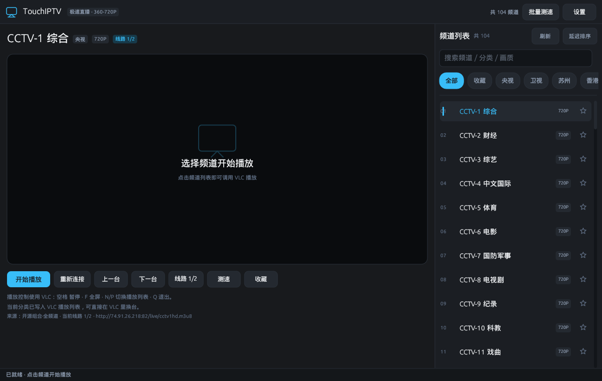
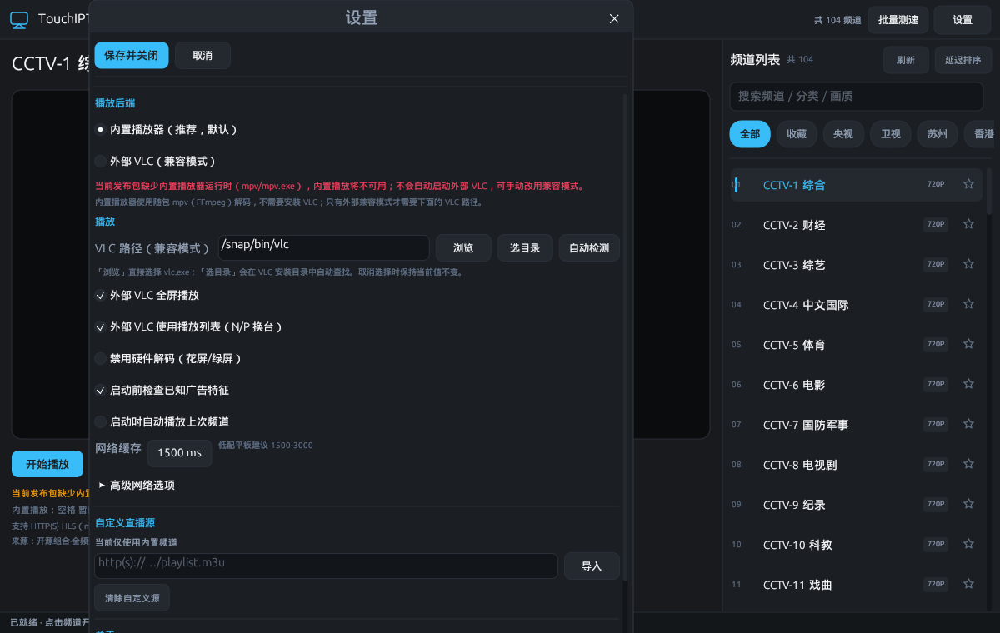
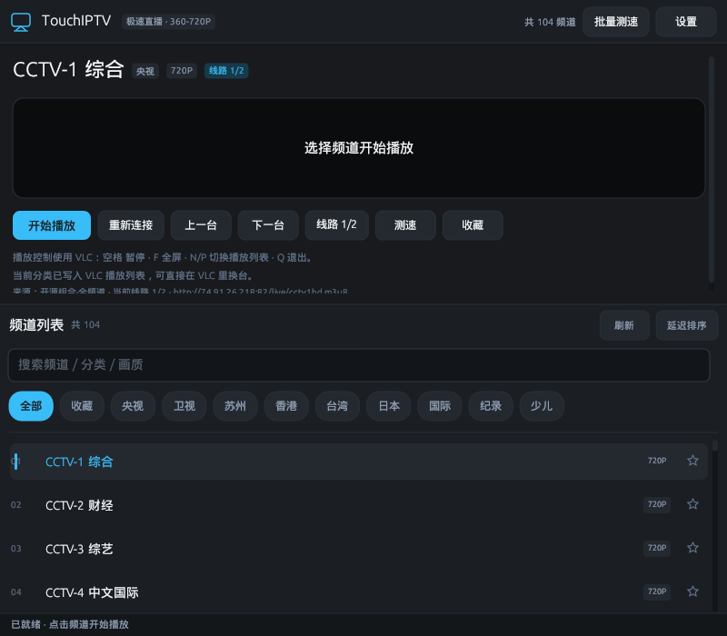

# TouchIPTV Desktop · Win32 直播版 / Win32 Live TV

**中文**
把原来的 Android 4.4 原生直播应用（`android/`）重写成适合 **Win32 低性能小平板** 的桌面程序。界面用 **Rust + eframe/egui**，直播默认由随包 **mpv（FFmpeg）** 在应用窗口内播放；外部 VLC 只作为可选的兼容模式。不是网页套壳，不使用 WebView。

**English**
A Win32 desktop rewrite of the original Android 4.4 live-TV app in `android/`, aimed at **low-spec Windows tablets**. The UI is **Rust + eframe/egui**; live channels play inside the app through a bundled **mpv (FFmpeg)** runtime. External VLC remains an optional compatibility mode. No WebView, no browser engine.

---

## 内置播放优先 / Built-in playback first

**中文**
内置播放器使用 **mpv i686 Windows 运行时**：mpv 进程通过 `--wid` 把画面渲染到应用自己的 Win32 子窗口，程序通过命名管道 JSON IPC 控制播放、暂停、音量和停止。mpv/FFmpeg 负责 HLS、TS、FLV、常见音视频编码、硬件解码与网络缓冲。

- 内置播放 **不依赖 VLC/libVLC**，用户不需要安装或启动外部 VLC。
- 发布 ZIP 自带 `mpv\mpv.exe`；源码仓库不提交二进制，GitHub Actions 构建时下载并校验 32 位 mpv。
- 内置播放失败时只显示错误和「改用 VLC 播放」按钮，**不会静默启动**外部程序。
- 只有用户选择外部兼容模式或主动点击回退按钮时，才会启动 `vlc.exe`。

**English**
The built-in player uses a **32-bit Windows mpv runtime**. mpv renders into a Win32 child window of the app via `--wid`; playback, pause, volume, and stop are controlled over a named-pipe JSON IPC. mpv/FFmpeg handles HLS, TS, FLV, common codecs, hardware decoding, and network buffering.

- Built-in playback does **not** depend on VLC/libVLC; users do not need to install or launch external VLC.
- Release ZIPs bundle `mpv\mpv.exe`. Binaries are not committed; GitHub Actions downloads and verifies the 32-bit mpv build.
- When built-in playback fails, the app shows an error and a “Use VLC” button. It **never silently launches** an external process.
- `vlc.exe` starts only when the user selects external compatibility mode or explicitly clicks the fallback button.

---

## 界面截图 / Screenshots

**主界面（铁灰主题，内置 104 个频道） / Main window (iron-gray, 104 bundled channels)**



**内置 mpv 播放（Wine 验证截图） / Built-in mpv playback (Wine verification)**


**设置（Linux 开发截图；Windows 下路径为 `vlc.exe`） / Settings (Linux dev screenshot; use `vlc.exe` on Windows)**



**窄窗口布局 / Narrow layout**



---

## 功能对照 / Feature parity

| Android 版功能 | Win32 版实现 |
| --- | --- |
| 104 个内置频道、分类胶囊 | ✅ 同一份 `assets/channels.json`，分类规则一比一移植 |
| 搜索名称 / 分类 / 画质 | ✅ 顶部搜索框实时过滤 |
| 收藏（点星 / 长按 / 右键） | ✅ 行尾星标、右键、长按都可切换 |
| 记住上次频道与分类 | ✅ 写入 `config.toml` |
| 单频道测速 / 批量测速 | ✅ 批量固定并发 3 路，结果直接标在列表 |
| 多线路切换与失败顺延 | ✅ 手动切线路；预检命中广告时自动顺延，外部 VLC 异常早退时自动顺延 |
| 广告流识别 | ✅ URL + HLS 清单预检；播放中途的限制见下文 |
| 播放引擎 | 内置 mpv（随包，32 位）；外部 VLC 为可选兼容模式 |
| 全屏 | 内置播放 `F` / 按钮全屏；外部 VLC 用 `--fullscreen` |
| 解码方式 | mpv/FFmpeg 自动硬解，可强制关闭；外部 VLC 同理 |
| 自定义 M3U | ✅ 支持 http(s) 地址导入、清除、与内置源合并 |
| 主题 | 铁灰单主题（低配平板优先暗色） |
| 画中画 / 剧场模式 | ❌ 未做 |
| 应用内暂停 / 音量 / 全屏 | ✅ 内置播放器支持；外部 VLC 使用 VLC 自带控制条 |

**中文**
内置播放器的播放/暂停、音量、全屏、换台都在应用内完成；切台、停止和退出时会结束 mpv 进程并销毁视频子窗口。
外部 VLC 兼容模式仍按原方式生成播放列表：当前筛选结果写入 M3U，选中频道排第一，之后可在 VLC 里用 `N` / `P` 换台。若更看重逐频道广告预检，可关闭「外部 VLC 使用播放列表」，每次换台都回到本程序重新预检。
内置播放失败后不会自动切到 VLC；错误提示旁会出现「改用 VLC 播放」，由用户决定是否启动外部程序。

**English**
The built-in player provides in-app play/pause, volume, fullscreen, and channel switching. Changing channels, stopping, and exiting terminate the mpv process and destroy the video child window.
External VLC compatibility mode still generates a playlist: the current filtered list is written to an M3U with the selected channel first, and `N` / `P` work inside VLC. Disable “external VLC playlist” if you prefer strict per-channel ad pre-checks.
A built-in failure never switches to VLC automatically; the error panel offers a “Use VLC” button so the user decides whether to start an external process.

---

## 技术方案 / Tech stack

**中文**
Rust · `eframe` / `egui` 0.27 · `reqwest`（blocking + rustls）· `serde` / `toml` / `serde_json` · `url` · 随包 mpv i686（FFmpeg）· 可选外部 VLC 3.x

**English**
Rust · `eframe` / `egui` 0.27 · `reqwest` (blocking + rustls) · `serde` / `toml` / `serde_json` · `url` · bundled mpv i686 (FFmpeg) · optional external VLC 3.x

---

## 目录结构 / Project layout

```text
.
|-- Cargo.toml
|-- config.example.toml
|-- DroidSansFallbackFull.ttf      # 内置 CJK 字体 / bundled CJK font
|-- assets/channels.json           # 104 个内置频道 / bundled channels
|-- packaging/windows/config.toml  # 发布包里的便携配置
|-- packaging/windows/MPV-NOTICE.txt # 随包 mpv 的来源与许可说明
|-- src/
|   |-- main.rs                    # 入口、字体、配置路径
|   |-- app.rs                     # 状态、播放会话、后台任务
|   |-- app_ui.rs                  # egui 界面
|   |-- config.rs                  # TOML 配置
|   |-- channels.rs                # 内置源 + 自定义源仓库
|   |-- m3u.rs                     # M3U/TXT 解析与分类
|   |-- models.rs                  # Channel / 播放状态
|   |-- net.rs                     # HTTP、测速、M3U 下载、广告预检
|   |-- adguard.rs                 # 广告特征识别
|   |-- embedded.rs                # 内置 mpv 进程、IPC、Win32 视频子窗口
|   |-- player.rs                  # 外部 VLC 探测、参数、播放列表
|   |-- jobs.rs                    # 后台线程与事件
|   `-- ui/
|       |-- channel_list.rs        # 虚拟化频道行、分类胶囊
|       `-- theme.rs               # 铁灰主题
|-- android/                       # 原 Android 工程（保留作对照）
|-- web-source/                    # 原网页版（保留作对照）
`-- dist/                          # 原 Android APK 与截图
```

---

## 运行要求 / Requirements

**中文**
- Windows 10 32 位或 64 位（发布目标为 `i686-pc-windows-msvc`，32 位 exe 也能在 64 位 Windows 上运行；Windows 8/7 未实测）
- 至少 2 GB 内存
- OpenGL 2.1 驱动（egui 的 `glow` 后端）。若窗口打不开，先更新显卡驱动
- **无需安装 VLC**：完整发布包已包含 `mpv\mpv.exe`。不要只复制 exe，需保留 `mpv` 文件夹
- 只有外部 VLC 兼容模式才需要 VLC 3.x；设置里可点「浏览」直接选择 `vlc.exe`，或用「选择安装目录」自动查找
- 32 位 Windows 必须使用 32 位运行库；随包 mpv 与发布 exe 都是 i686

**English**
- Windows 10, 32-bit or 64-bit (the release target is `i686-pc-windows-msvc`; the 32-bit exe also runs on 64-bit Windows; Windows 8/7 are untested)
- At least 2 GB RAM
- OpenGL 2.1 drivers (egui `glow` backend). Update the GPU driver if the window fails to open
- **No VLC installation required**: the complete release ZIP includes `mpv\mpv.exe`. Keep the `mpv` folder next to the exe
- VLC 3.x is needed only for external compatibility mode; Settings can pick `vlc.exe` directly or locate it from an installation folder
- 32-bit Windows requires 32-bit runtimes; the bundled mpv and the release exe are both i686

---

## 构建 / Build

**中文**
Linux 本地开发：

```bash
./start.sh            # debug
./start.sh --release  # release
```

或直接：

```bash
cargo run --release
```

Windows 32 位发布构建（需要 Rust + Visual Studio Build Tools）：

```powershell
rustup target add i686-pc-windows-msvc
cargo build --release --target i686-pc-windows-msvc
```

产物：`target\i686-pc-windows-msvc\release\touchiptv-desktop.exe`。

`.cargo/config.toml` 已为 MSVC 目标启用静态 CRT，尽量减少目标平板缺少 `vcruntime140.dll` 的问题。

本地运行时还需要 32 位 mpv：把 mpv 的 `mpv.exe` 放到 exe 同目录的 `mpv\mpv.exe`。GitHub Actions 会自动下载固定版本并校验 SHA-256；本地构建不会自动下载。也可以把 `mpv.exe` 直接放在 exe 同目录。

**English**
Linux development:

```bash
./start.sh            # debug
./start.sh --release  # release
```

Or:

```bash
cargo run --release
```

Windows 32-bit release (Rust + Visual Studio Build Tools required):

```powershell
rustup target add i686-pc-windows-msvc
cargo build --release --target i686-pc-windows-msvc
```

Output: `target\i686-pc-windows-msvc\release\touchiptv-desktop.exe`.

`.cargo/config.toml` enables static CRT for MSVC targets to avoid missing `vcruntime140.dll` on target tablets.

---

## GitHub Actions 构建 / GitHub Actions build

**中文**
仓库内含 `.github/workflows/windows-win32.yml`：

- 在 `windows-latest` 上构建 `i686-pc-windows-msvc`
- 静态链接 MSVC C 运行库
- 下载并校验固定版本的 32 位 mpv，随包放入 `mpv\mpv.exe`
- 产出可直接分发的 `.zip`：`touchiptv-desktop.exe`、`mpv\mpv.exe`、`config.toml`、字体、`README.md`、截图、`LICENSE-RUST`、mpv 许可说明
- 推送到 `main` / `master`，且本次推送最后一条提交消息包含 `[deploy]` 时，才执行 Win32 测试、构建和 ZIP 打包；例如 `[deploy] 修复直播源导入`。普通提交跳过构建，不提供手动触发入口

**English**
The repo includes `.github/workflows/windows-win32.yml`:

- Builds `i686-pc-windows-msvc` on `windows-latest`
- Statically links the MSVC C runtime
- Downloads and verifies a pinned 32-bit mpv build and bundles it as `mpv\mpv.exe`
- Uploads a ready-to-share `.zip`: `touchiptv-desktop.exe`, `mpv\mpv.exe`, `config.toml`, the font, `README.md`, screenshots, `LICENSE-RUST`, and the mpv notice
- Runs Win32 tests, the release build, and ZIP packaging only when the latest commit message in a push to `main` / `master` contains `[deploy]`, for example `[deploy] Fix source import`. Ordinary commits skip the build; manual dispatch is disabled

---

## 配置 / Configuration

**中文**
配置查找顺序：

1. 当前工作目录的 `config.toml`
2. exe 同目录的 `config.toml`（双击启动的便携模式）
3. 系统应用数据目录（Windows 为 `%APPDATA%\gathin\TouchIPTV\config`）

把 `config.example.toml` 改名为 `config.toml` 放在 exe 同目录即可便携运行。

主要配置项：

| 键 | 说明 |
| --- | --- |
| `player_backend` | `embedded`（默认，内置 mpv）或 `external_vlc`（外部 VLC） |
| `vlc_path` | 外部 VLC 路径；留空自动探测。内置模式可为空 |
| `embedded_volume` | 内置播放器音量，0-100，默认 80 |
| `last_channel_key` | 上次频道（内部 key，不建议手改） |
| `last_filter` | 上次分类 |
| `favorites` | 收藏频道 key 列表 |
| `custom_source_url` | 自定义 M3U 地址（界面导入成功后自动写入） |
| `fullscreen` | 外部 VLC 是否全屏；内置播放用 `F` 或按钮 |
| `use_playlist` | 外部 VLC 是否生成播放列表 |
| `network_caching_ms` | 外部 VLC 网络缓存，默认 1500 |
| `disable_hw_decode` | 强制关闭内置 mpv / 外部 VLC 的硬件解码 |
| `ad_guard` | 启动前检查已知广告特征 |
| `auto_play_last` | 启动时自动播放上次频道（默认关闭） |
| `user_agent` | 可选 HTTP UA；留空使用播放器默认值 |
| `referer` | 可选 HTTP Referer |

**English**
Config lookup order:

1. `config.toml` in the current working directory
2. `config.toml` next to the exe (portable double-click mode)
3. OS app-data directory (`%APPDATA%\gathin\TouchIPTV\config` on Windows)

Rename `config.example.toml` to `config.toml` next to the exe for portable use.

See the table above for the main keys. `player_backend` defaults to the bundled mpv player; `external_vlc` opts into VLC compatibility. `vlc_path` may stay empty in embedded mode. `use_playlist` trades strict per-channel pre-checks for in-VLC channel switching; `network_caching_ms` is the external VLC network cache and defaults to 1500.

---

## 使用说明 / Usage

**中文**
- 顶部胶囊切换分类；搜索框按名称 / 分类 / 画质过滤
- 点击频道行开始播放；行尾星标、右键或长按切换收藏
- 播放区按钮：停止、暂停/继续、音量、全屏、重新连接、上一台、下一台、切换线路、测速、收藏
- 内置播放失败时：错误面板显示原因，点击「改用 VLC 播放」才会启动外部 VLC
- 设置：播放后端、VLC 路径（浏览 / 选择安装目录 / 自动检测）、全屏、播放列表、硬件解码、广告预检、自动续播、网络缓存、UA/Referer、自定义 M3U
- 快捷键：`空格` 暂停/继续，`F` 全屏，`+/-` 音量，`N/P` 换台，`↑/↓` 换台，`Enter` 播放选中频道，`Esc` 退出全屏或停止，`F5` 刷新频道列表，数字键 `1-5` 切换线路（搜索框获得焦点时快捷键不生效）
- 外部 VLC 内：`空格` 暂停，`F` 全屏，`N/P` 下一台/上一台，`Q` 退出
- 画面花屏/绿屏时，在设置里勾选「禁用硬件解码」
- 频道源卡顿时，把网络缓存调到 2000-3000 ms

**English**
- Category chips at the top; the search box filters by name / group / resolution
- Click a channel row to play; the star at the row end, right-click, or long-press toggles favorite
- Player buttons: stop, pause/resume, volume, fullscreen, reconnect, previous, next, switch line, speed test, favorite
- Built-in failure shows the reason; external VLC starts only after clicking “Use VLC”
- Settings: playback backend, VLC path (browse / choose folder / auto-detect), fullscreen, playlist, hardware decode, ad guard, auto-resume, network cache, UA/Referer, custom M3U
- Shortcuts: `Space` pause/resume, `F` fullscreen, `+/-` volume, `N/P` change channel, `Up/Down` change channel, `Enter` play selected, `Esc` exit fullscreen or stop, `F5` refresh, number keys `1-5` switch lines (disabled while the search box has focus)
- In external VLC: `Space` pause, `F` fullscreen, `N/P` next/previous, `Q` quit
- If the picture is green or corrupted, enable “disable hardware decode” in Settings
- If a stream stutters, raise network caching to 2000-3000 ms

---

## 广告预检 / Ad guard

**中文**
从 Android 版移植了同一组已知广告特征：

- 播放列表路径：`/applive/mkt.m3u8`、`/applive/byt.m3u8`、`/applive/yss.m3u8`
- 片段路径：`mkt/segment_*.ts`、`byt/segment_*.ts`、`yss/segment_*.ts`
- 路径段：`appadhw`、`zjstream2`
- 查询参数：`a=tvzb0006`、`app=tvzb0006`

启动前会检查：

1. 原始 URL
2. 重定向后的最终 URL
3. HLS 主清单正文（只扫描实际 URI 行和 `URI="..."` 属性）
4. 主清单里的前两个子清单

命中后自动尝试当前频道的下一条线路；全部命中则阻止播放并提示。

**限制（重要）**
播放开始后，内置 mpv 或外部 VLC 自己发起的请求不在本程序的控制范围内：

- 播放中途才插入的广告无法拦截
- 播放开始后，播放器的请求不经过本程序；HTTPS 清单和 HTTP 中途清单都无法再检查（没有 MITM/本地代理）
- 只有外部 VLC 兼容模式会生成播放列表；启用播放列表时，只有选中的频道经过预检，在 VLC 里用 `N/P` 切到的其他频道不会重新预检

如果需要更严格的逐频道预检，请使用内置播放器，或关闭「外部 VLC 使用播放列表」，并只在本程序里换台。

**English**
The same known ad signatures as the Android app are ported:

- Playlist paths: `/applive/mkt.m3u8`, `/applive/byt.m3u8`, `/applive/yss.m3u8`
- Segment paths: `mkt/segment_*.ts`, `byt/segment_*.ts`, `yss/segment_*.ts`
- Path segments: `appadhw`, `zjstream2`
- Query parameters: `a=tvzb0006`, `app=tvzb0006`

Before launch, the app checks:

1. The original URL
2. The final URL after redirects
3. The HLS manifest body (only actual URI lines and `URI="..."` attributes)
4. The first two variant playlists

On a hit, it automatically tries the next line of the same channel; if every line is blocked, playback is refused with an explanation.

**Important limitations**
Once built-in mpv or external VLC starts, its requests are outside the launcher’s control:

- Ads inserted mid-playback cannot be blocked
- After launch, the player’s requests do not pass through the launcher; HTTPS bodies and mid-playback HTTP manifests cannot be inspected (there is no MITM/local proxy)
- Only external VLC compatibility mode generates a playlist; with the playlist enabled, only the selected channel is pre-checked, and channels reached via `N/P` inside VLC are not re-checked

For stricter per-channel checks, use the built-in player or disable “external VLC playlist” and switch channels only in the launcher.

---

## 低配优化 / Low-end optimizations

**中文**
- 界面进程不加载网页，不使用 WebView；解码由独立的 mpv 进程承担
- 无动画、无海报图、无渐变/模糊；列表只绘制可见行
- 批量测速固定 3 路并发，避免老平板同时开太多连接
- 频道列表按固定行高虚拟化，自定义源几千个频道也不卡
- 后台任务全部走线程 + mpsc，UI 线程不做网络请求
- 32 位 exe + 静态 CRT + `opt-level = "s"` + LTO
- 网络缓存默认 1500 ms，可按源稳定性调整
- 硬件解码默认交给 mpv/FFmpeg 自动选择

**English**
- The UI does not load web pages or use a WebView; decoding runs in a separate mpv process
- No animations, posters, gradients, or blur; only visible list rows are drawn
- Batch speed tests use exactly 3 concurrent workers
- Fixed-row-height virtualized list handles thousands of custom channels
- All network work runs on background threads with mpsc; the UI thread never blocks
- 32-bit exe + static CRT + `opt-level = "s"` + LTO
- Default 1500 ms network cache, adjustable per source stability
- Hardware decode is left to mpv/FFmpeg’s automatic choice

---

## 已知限制 / Known limitations

**中文**
- 公共直播源本身不稳定；部分频道可能已经失效、限地区或需要特定 UA/Referer
- 内置播放依赖发布包中的 `mpv\mpv.exe`；缺失时不会自动改用外部 VLC，界面会提示并等待用户选择
- 内置 mpv 不支持 DRM/加密流、网页地址或 mpv 不支持的编码；HLS/FLV/TS 之外的协议取决于随包 mpv 的 FFmpeg 能力
- 画面比例固定按源显示（保留黑边），暂无手动画面比例按钮
- 外部 VLC 的详细错误对话框由 VLC 自己显示，本程序无法读取；失败时请用「重新连接」或切换线路
- 自定义源目前只支持 http(s) 地址，不支持本地文件选择器
- 未实现画中画、剧场模式、白天主题
- 外部 VLC 全屏通常打开在主显示器；多屏环境可能需要手动移动窗口
- 广告预检只覆盖启动前（URL + 清单）；播放中途的请求不经过本程序，详见上一节
- 若 OpenGL 2.1 驱动不可用，egui 窗口可能无法启动
- 内置 104 个频道来自原 Android 工程，可能随时间失效；建议导入自己的 M3U

**English**
- Public IPTV sources are inherently unstable; some may be dead, geo-blocked, or require a specific UA/Referer
- Built-in playback needs `mpv\mpv.exe` from the release ZIP. A missing runtime never triggers an automatic VLC launch; the UI waits for the user to choose
- Built-in mpv does not support DRM/encrypted streams, web-page URLs, or codecs unavailable in its FFmpeg build; protocols beyond HLS/FLV/TS depend on the bundled mpv build
- Aspect ratio follows the source (letterboxed); there is no manual aspect-ratio control yet
- Detailed external VLC error dialogs are owned by VLC and cannot be read by the launcher; use Reconnect or switch lines when playback fails
- Custom sources support http(s) URLs only; there is no local file picker
- No PiP, theater mode, or day theme
- External VLC fullscreen usually opens on the primary monitor; multi-monitor setups may need manual window movement
- Ad guard covers pre-launch checks (URL + manifests) only; requests made during playback do not pass through the launcher—see the previous section
- If OpenGL 2.1 is unavailable, the egui window may fail to start
- The 104 bundled channels come from the original Android project and may age; importing your own M3U is recommended

---

## 数据与字体 / Data and fonts

**中文**
- `assets/channels.json` 来自原 Android 工程的 `android/app/src/main/assets/channels.json`
- `DroidSansFallbackFull.ttf` 为内置 CJK 字体，确保 Win32 上中文正常显示；字体遵循其原始 Apache 2.0 许可
- 原 Android 工程与网页版源码保留在 `android/`、`web-source/`，方便对照
- 新增的 Rust 代码以 MIT 许可发布（见 `LICENSE-RUST`）；内置频道数据与字体遵循原项目/字体许可
- 发布包内的 mpv 为 GPLv2+ 第三方程序，来源与许可见 `packaging/windows/MPV-NOTICE.txt` 和 `MPV-GPL-2.0.txt`

**English**
- `assets/channels.json` comes from the original Android project
- `DroidSansFallbackFull.ttf` is bundled for reliable CJK rendering on Win32; it follows its original Apache 2.0 license
- The original Android project and web source remain in `android/` and `web-source/` for reference
- The new Rust code is released under MIT (see `LICENSE-RUST`); bundled channel data and fonts follow their original project/font licenses
- The bundled mpv runtime is GPLv2+ third-party software; see `packaging/windows/MPV-NOTICE.txt` and `MPV-GPL-2.0.txt`

---

## 快速开始 / Quick start

**中文**
1. 解压完整发布包（必须保留 `mpv` 文件夹），双击 `touchiptv-desktop.exe`
2. 点一个频道，内置播放器在应用窗口内开始播放
3. 用播放区按钮或 `空格` / `F` / `N` / `P` 控制暂停、全屏和换台
4. 内置播放失败时，按提示决定是否点击「改用 VLC 播放」（需先安装 VLC）
5. 需要自己的源时，在设置里粘贴 M3U 地址并点「导入」

**English**
1. Unzip the complete release (keep the `mpv` folder) and run `touchiptv-desktop.exe`
2. Click a channel; the built-in player starts inside the app window
3. Use the controls or `Space` / `F` / `N` / `P` for pause, fullscreen, and channel switching
4. If built-in playback fails, decide whether to click “Use VLC” (VLC must be installed)
5. To use your own source, paste an M3U URL in Settings and click Import
